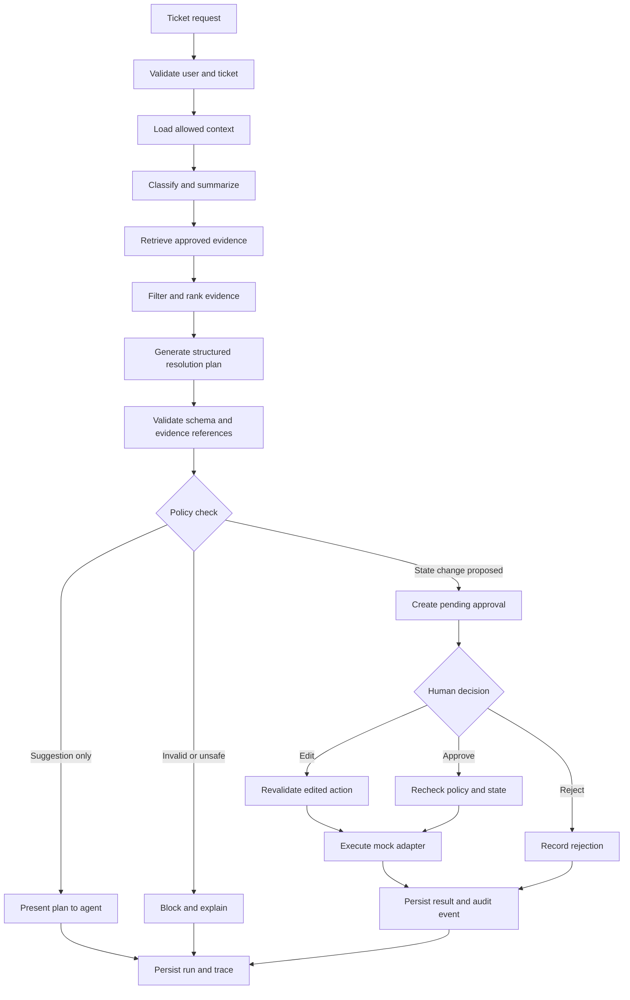
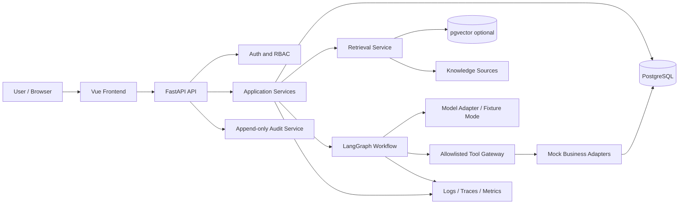

# FieldOps AI - Product Requirements Document (PRD)

**Version:** 1.0  
**Status:** Proposed portfolio MVP specification  
**Product type:** AI-assisted operations workflow and ticket-resolution workspace  
**Prepared for:** Independent portfolio build  
**Document owner:** Muhammed Nibras  
**Last updated:** 20 October 2026  
**Data policy for the demo:** Synthetic data only  
**Implementation status:** Not yet built; this document describes the proposed product and acceptance criteria.

> **Important truth label:** FieldOps AI is a proposed portfolio project, not a completed product, deployed customer system, or verified business. All sample companies, tickets, metrics, integrations, outcomes, and users described below are fictional or synthetic unless explicitly identified as external technical references.

---

## Document map

1. Executive summary
2. Product context and problem
3. Vision, goals, and non-goals
4. Users, roles, and permissions
5. Core workflows
6. Functional requirements
7. Screen-by-screen UI/UX specification
8. AI and agent behavior specification
9. Integration design
10. Technical architecture
11. Data model
12. API specification
13. Security, privacy, and responsible AI
14. Evaluation and observability
15. Non-functional requirements
16. Analytics and product metrics
17. Acceptance criteria and test plan
18. Delivery roadmap
19. Risks and mitigations
20. Demo strategy and portfolio proof
21. Open decisions
22. Glossary
23. Technical references

---

# 1. Executive summary

## 1.1 Product summary

FieldOps AI is an AI-assisted operations workspace that helps a support or field-operations team move from a raw ticket to a reviewed, documented resolution. The system gathers relevant context from a synthetic knowledge base and mock business systems, proposes a response and next steps, lets an authorized human review or edit proposed actions, and records what was approved, rejected, simulated, or completed.

The product is deliberately designed around **assisted resolution, not autonomous control**. In the portfolio MVP, external integrations are simulated. The agent does not send real customer messages, modify real business records, dispatch technicians, spend money, or execute destructive operations. Any consequential action must pass policy checks and an explicit human approval step; in the demo, an approved action changes only a local simulated record.

## 1.2 Problem statement

Operations teams often work across separate sources: tickets, internal procedures, asset or customer records, past incident notes, and communication tools. A human operator may spend time locating relevant information, summarizing it, identifying the right procedure, drafting a response, deciding the next action, and writing an audit trail. General-purpose chat alone does not provide a dependable workflow, permissioned tool execution, approval states, or traceable outcomes.

FieldOps AI tests whether a structured workflow can reduce repetitive investigation work while keeping humans accountable for decisions and external actions.

## 1.3 Proposed solution

The application provides:

- A queue of synthetic operational tickets with priority, status, owner, category, SLA target, and customer/asset context.
- A ticket workspace that combines ticket details, relevant knowledge sources, similar historical cases, an AI-generated summary, recommended next steps, and an editable response draft.
- A bounded agent workflow that classifies a ticket, retrieves evidence, prepares a resolution plan, checks permissions and policy, and requests approval when needed.
- A review inbox where a person can approve, edit, or reject proposed actions with a recorded reason.
- A simulated integration layer that shows tool calls and outcomes without touching external systems.
- An audit trail and evaluation workspace so reviewers can understand what the agent did, what evidence it used, what a human changed, and how the run performed.

## 1.4 Intended portfolio signal

A completed implementation should demonstrate applied skills in full-stack delivery, Python APIs, workflow orchestration, RAG, SQL/data modeling, integration patterns, human-in-the-loop design, AI evaluation, security controls, automated testing, and deployment. These are target capabilities, not claims of work already completed.

## 1.5 MVP success definition

The MVP is successful when a reviewer can run a repeatable end-to-end demonstration using synthetic data:

1. Open a ticket from the queue.
2. Start an AI investigation.
3. See the sources and tool results used by the workflow.
4. Review an actionable, evidence-linked plan.
5. Approve, edit, or reject a proposed action.
6. Observe the simulated action result and audit event.
7. Inspect the run trace and evaluation result.
8. Repeat the same test case and compare outcomes.

No business impact should be claimed until measured on a defined test set or real, authorized pilot.

---

# 2. Product context and problem

## 2.1 Target scenario

The initial domain is **internal IT/helpdesk or field-service operations support**. Example tickets include an employee unable to connect to a VPN, a device reporting an error, an access request, or a technician needing a documented troubleshooting procedure. The workflow is designed to generalize later to customer support and service operations, but the MVP will support one primary ticket-resolution workflow only.

## 2.2 Primary users and jobs-to-be-done

- **Operations agent / technician:** “Help me understand this ticket faster, find trusted instructions, and prepare a useful response without losing control of the decision.”
- **Operations lead / reviewer:** “Help me review proposed actions consistently, see risky or unsupported recommendations, and understand the state of the queue.”
- **Workspace administrator:** “Help me manage users, role permissions, knowledge sources, synthetic connectors, and demo configuration.”
- **Portfolio reviewer:** “Help me verify that the system is more than a chatbot: I need to inspect architecture, tests, approval controls, traces, evaluation results, and known limitations.”

## 2.3 Current-state hypothesis

The project assumes that a team using disconnected tools may repeat context gathering and manual documentation. This is a hypothesis to validate through interviews or a simulated workflow exercise, not a claim that every operations team has this problem or that FieldOps AI has already reduced work.

## 2.4 Opportunity

The opportunity is not simply “use AI to answer a ticket.” It is to connect an AI recommendation to the real operational workflow around it:

- Context retrieval with citations.
- Typed and validated action proposals.
- Human ownership and approval.
- Safe execution boundaries.
- Repeatable quality checks.
- A complete audit history.

## 2.5 Design principles

1. **Evidence before confidence:** recommendations should show source material and disclose missing evidence.
2. **Human accountability:** AI proposes; authorized people decide on consequential actions.
3. **Least privilege:** each role and tool can do only what is necessary.
4. **Explicit states:** show whether work is proposed, awaiting approval, rejected, simulated, or completed.
5. **Inspectable behavior:** provide run timelines, tool inputs/outputs with secrets and unnecessary PII redacted, and error details.
6. **Honest measurement:** label demo data, simulations, and synthetic metrics clearly.
7. **Graceful failure:** when retrieval, a model, or a connector fails, preserve the ticket and explain what did not happen.
8. **Build for the smallest useful workflow:** do not add multi-agent complexity before the single-agent workflow is reliable.

---

# 3. Vision, goals, and non-goals

## 3.1 Vision

Give operations teams a transparent, reviewable AI workflow that helps investigate tickets and prepare safe next steps while preserving human ownership.

## 3.2 MVP goals

- Provide an end-to-end ticket investigation and resolution workflow.
- Retrieve relevant internal knowledge with source-level references.
- Produce structured summaries, recommendations, and action proposals.
- Support approval, edit, and rejection for consequential proposals.
- Simulate integrations using deterministic local adapters.
- Record a durable audit trail for user decisions and tool lifecycle events.
- Capture basic traces, timing, token/cost estimates when available, model/provider configuration, and evaluation scores.
- Offer an accessible responsive interface and a clear demo-reset path.
- Deliver automated tests, setup documentation, synthetic seed data, and a reproducible local deployment.

## 3.3 Non-goals for MVP

- Real customer production deployment.
- Use of real customer or employee personal data.
- Automatic sending of external email, WhatsApp, SMS, or customer communications.
- Real technician dispatch or physical-world actions.
- Payments, refunds, account suspension, deletion, permission grants, or other destructive/high-impact operations.
- Autonomous ticket closure without human review.
- Training or fine-tuning a foundation model.
- A general-purpose agent that can run arbitrary code or arbitrary SQL.
- Multi-tenant SaaS billing, subscription administration, or enterprise SSO in the first release.
- Guarantees of legal, regulatory, or security compliance.
- Claims of measurable ROI until the system is evaluated against a documented baseline.

## 3.4 Release boundaries

- **MVP:** local synthetic data, single workspace, mock connectors, bounded tool allowlist, human approval, audit log, basic evaluation page.
- **Pilot candidate:** optional real read-only connector with explicit authorization, integration-specific threat modeling, access review, data-protection review, and operational monitoring.
- **Production candidate:** only after security review, customer-specific policy configuration, retention/access controls, incident response procedures, and measured evaluation meet acceptance thresholds.

---

# 4. Users, roles, and permissions

## 4.1 Roles

### Workspace Admin
- Manage demo workspace settings.
- Configure synthetic knowledge sources and mock connectors.
- Create/deactivate demo users and assign roles.
- View all tickets, runs, reviews, audit events, and evaluation results.
- Reset synthetic demo data.
- Cannot bypass the approval policy in the MVP.

### Operations Lead / Reviewer
- View queue and ticket details.
- Run or rerun investigations.
- Review proposed actions.
- Approve, edit, or reject proposals within assigned policy.
- View team queue metrics, run traces, and audit events.
- Cannot change system-wide security settings unless also an Admin.

### Operations Agent / Technician
- View tickets assigned to them or visible to their team.
- Start an investigation and inspect cited evidence.
- Edit a proposed response before submitting it for review.
- Submit a proposal for approval.
- View their own actions and decisions.
- Cannot approve their own high-risk action by default; this prevents a single-person approval bypass in the demo workflow.

### Read-only / Portfolio Reviewer
- Explore seeded tickets, demo runs, trace timelines, and evaluation results.
- Cannot change tickets, trigger tool execution, change roles, or reset data unless demo configuration explicitly enables a separate reset action behind a confirmation gate.

## 4.2 Permission matrix

| Capability | Admin | Lead/Reviewer | Agent/Technician | Read-only |
|---|---:|---:|---:|---:|
| View allowed tickets | Yes | Yes | Assigned/team | Yes, demo scope |
| Start AI investigation | Yes | Yes | Yes | No |
| View source citations | Yes | Yes | Yes | Yes |
| Draft/edit recommendation | Yes | Yes | Yes | No |
| Approve or reject action | Yes, policy-bound | Yes, policy-bound | Not own high-risk proposal | No |
| View full audit timeline | Yes | Yes | Own/team scope | Demo-visible subset |
| Configure mock connectors | Yes | No | No | No |
| Manage users/roles | Yes | No | No | No |
| Reset synthetic dataset | Yes | No | No | No |
| Trigger real external side effects | No in MVP | No in MVP | No in MVP | No |

## 4.3 Authorization requirements

- Authorization must be enforced by the backend for every protected API, not only by hiding UI controls.
- Every record query must be scoped by workspace and user/team authorization.
- Approval and execution endpoints must re-check permission, proposal state, expiry, and policy at the time of action.
- The requested action must be validated against a server-side allowlist. Never rely on the model to enforce its own permissions.
- The demo must not include a universal “superuser AI” tool.

---

# 5. Core workflows

## 5.1 Workflow A - Investigate a ticket

**Trigger:** An authorized agent opens a ticket and chooses “Investigate with FieldOps AI.”

1. API validates user, workspace, ticket state, and rate limits.
2. Backend creates an investigation run with status `queued`.
3. Agent workflow loads ticket fields and allowed mock context.
4. Classifier proposes category, urgency, and short summary. Deterministic rules provide a safe fallback if model output is invalid.
5. Retrieval service searches approved knowledge chunks and synthetic past cases using lexical and vector/hybrid retrieval where configured.
6. Evidence filter removes out-of-scope or inaccessible results and returns source titles, snippets, IDs, relevance signals, and version metadata.
7. Agent generates a structured resolution plan with steps, evidence references, caveats, and a recommended next action.
8. Policy engine validates the proposed action type, required fields, risk class, and permitted role.
9. A low-risk, non-side-effecting suggestion can be displayed as a draft. Any state-changing operation must enter `awaiting_approval`.
10. UI displays the result, evidence, caveats, and run timeline.
11. Run outputs and events are persisted; errors become visible and do not silently disappear.

**Expected result:** An inspectable investigation report and, if applicable, a pending action proposal. Investigation completion does not mean the ticket was resolved.

## 5.2 Workflow B - Review a proposed action

1. Reviewer opens the review inbox and selects a proposal.
2. Review screen shows ticket context, agent rationale, evidence, risk label, exact action payload, mock target, and side-effect statement.
3. Reviewer selects one of:
   - **Approve:** approve the exact displayed payload.
   - **Edit and approve:** modify permitted fields; the edited payload is validated again.
   - **Reject:** require a reason or choose a rejection category.
4. Backend verifies reviewer authorization and that the proposal is still pending and not expired.
5. If approved, execution service re-checks policy, idempotency key, and current record state.
6. In the MVP, mock adapter executes only against synthetic local records and returns a deterministic simulated result.
7. Approval/rejection/edit and execution result are persisted in the audit trail.
8. UI shows a clear result: `approved`, `rejected`, `simulated_success`, `simulated_failure`, or `expired`.

A reviewer decision cannot be silently overwritten. Edited proposals retain the original payload and a versioned record of the accepted changes.

## 5.3 Workflow C - View and diagnose a run

1. User opens Run History or a ticket’s run panel.
2. System displays graph steps, event timestamps, durations, retries, tool calls, source references, validation failures, and final status.
3. Sensitive fields are redacted or omitted from logs.
4. User can expand a step to see sanitized inputs and outputs.
5. Authorized admin can mark a run as an evaluation sample and add a reviewer label; editing a label does not rewrite the original run output.

## 5.4 Workflow D - Run an evaluation set

1. Admin or reviewer selects a versioned synthetic evaluation set.
2. System runs each test case with a recorded model configuration and retrieval configuration.
3. Each result stores expected behavior, actual output, individual metric values, error states, latency, and applicable cost estimate.
4. Evaluation summary shows pass/fail by case and metric; it must not collapse quality into a single unlabeled “AI score.”
5. User compares two configuration runs using the same dataset version.
6. A release cannot be described as “better” without showing the evaluation set, metric definitions, sample size, and relevant differences.

## 5.5 Workflow E - Recover from failure

- If the model provider times out, retry only within a capped policy; record each attempt.
- If retrieval fails, show an explicit evidence-service error and do not fabricate source citations.
- If structured output validation fails, allow one bounded repair attempt or fall back to a safe “unable to generate a validated plan” state.
- If approval execution fails, preserve approval metadata, record failure, and make retry idempotent.
- If a run is interrupted, show it as interrupted/failed and provide a retry action when safe.
- Never report a simulated or failed action as completed.

---

# 6. Functional requirements

Priority key: **P0** required for MVP; **P1** valuable after the core workflow; **P2** future enhancement.

## 6.1 Workspace and navigation

- **FR-001 (P0):** Provide authenticated demo access or a clearly documented local-demo auth mode. Demo mode must be obvious and never represented as production authentication.
- **FR-002 (P0):** Provide persistent primary navigation: Overview, Tickets, Reviews, Runs, Knowledge, Evaluations, Audit Log, Settings.
- **FR-003 (P0):** Display a consistent demo/synthetic-data indicator in the app shell.
- **FR-004 (P0):** Provide user identity and current role; role switching, if included for demos, must be labeled as simulated and must not be a production security mechanism.
- **FR-005 (P1):** Support light/dark theme and remember preference locally.

## 6.2 Ticket queue

- **FR-010 (P0):** Display tickets with ID, title, category, priority, status, assignee, created time, SLA target, and AI-run state.
- **FR-011 (P0):** Filter by status, priority, category, assignee, and AI-run state.
- **FR-012 (P0):** Search tickets by ID, title, sanitized description, and asset/customer alias.
- **FR-013 (P0):** Sort by priority, last updated, created time, and SLA proximity.
- **FR-014 (P0):** Show clear empty, loading, and error states.
- **FR-015 (P1):** Bulk selection can change only safe local assignment/status fields and must show a confirmation summary. No bulk external actions.

## 6.3 Ticket detail

- **FR-020 (P0):** Show ticket summary, description, metadata, assigned team, asset/customer synthetic context, timeline, comments, and related cases.
- **FR-021 (P0):** Show all AI investigations associated with the ticket.
- **FR-022 (P0):** Provide “Investigate with AI,” “Re-run investigation,” and “Add human note” actions, subject to user role and rate limits.
- **FR-023 (P0):** Keep original ticket content immutable in the audit history; edits create new versions/events.
- **FR-024 (P1):** Let an agent compare two run summaries side by side.

## 6.4 AI investigation

- **FR-030 (P0):** Create a run record before invoking the model so the user can inspect status if the request fails.
- **FR-031 (P0):** Classify the ticket using a constrained taxonomy: access, connectivity, hardware/device, application, request, or other.
- **FR-032 (P0):** Retrieve permitted knowledge chunks and optionally related synthetic cases.
- **FR-033 (P0):** Show citation/source references for substantive knowledge-backed recommendations.
- **FR-034 (P0):** If evidence is insufficient or conflicting, explicitly state uncertainty and list what information is missing.
- **FR-035 (P0):** Return validated structured output containing summary, category, urgency suggestion, evidence list, recommended steps, draft response, action proposal(s), caveats, and human-review requirement.
- **FR-036 (P0):** No model-generated arbitrary SQL, shell, or unbounded URL fetch is executable by the system.
- **FR-037 (P0):** Apply configured retry limits and deadlines; record provider failures.
- **FR-038 (P0):** Support a deterministic fixture/mock model mode so end-to-end tests do not require paid model access.
- **FR-039 (P1):** Allow authorized reviewers to label output as helpful, partially helpful, or unhelpful and enter a short reason.

## 6.5 Knowledge base and retrieval

- **FR-040 (P0):** Seed a versioned synthetic knowledge corpus containing troubleshooting guides, access procedures, and operating policies.
- **FR-041 (P0):** Store each source with title, type, owner, version, status, created/updated dates, and visibility scope.
- **FR-042 (P0):** Chunk documents with stable source and chunk IDs; preserve title and section metadata.
- **FR-043 (P0):** Search must apply access and status filters before evidence is supplied to the model.
- **FR-044 (P0):** Citation clicks open the exact source and relevant snippet/section.
- **FR-045 (P0):** Support document version updates; old versions remain traceable for prior runs.
- **FR-046 (P1):** Support manual upload of text/Markdown/PDF only after input validation, malware scanning strategy, size limits, and safe extraction are designed. For earliest MVP, seeded Markdown/JSON is sufficient.
- **FR-047 (P1):** Expose lexical, vector, and hybrid retrieval mode labels for evaluation comparisons if all modes are implemented.

## 6.6 Action proposals and approvals

- **FR-050 (P0):** Action proposals use a typed allowlist such as `assign_ticket`, `add_internal_note`, `draft_customer_reply`, `request_more_information`, and `change_local_status`.
- **FR-051 (P0):** In MVP, all action execution targets a mock adapter/local synthetic state only.
- **FR-052 (P0):** Any proposed state change must include a human-readable summary, typed payload, stated expected effect, risk class, evidence references, and rollback/reversal note when applicable.
- **FR-053 (P0):** Proposals that change state require approval before execution.
- **FR-054 (P0):** Reviewer may approve, edit-and-approve, or reject; rejection reason is recorded.
- **FR-055 (P0):** The exact action payload shown during review must match the approved payload executed by the adapter.
- **FR-056 (P0):** The server revalidates the proposal, role, state, tenant scope, policy, and idempotency key before execution.
- **FR-057 (P0):** Approval expires after configurable duration; expired proposals cannot execute.
- **FR-058 (P0):** Prevent duplicate execution by idempotency key and execution-state check.
- **FR-059 (P0):** Never auto-retry a side effect unless the adapter guarantees idempotency and policy allows it.
- **FR-060 (P1):** Provide configurable two-person review for selected action categories.

## 6.7 Run history and audit

- **FR-070 (P0):** Persist run ID, ticket ID, initiating user, model/config version, workflow version, status, timestamps, and error code.
- **FR-071 (P0):** Store sanitized step events, tool request/response metadata, retrieval references, validation outcomes, and retry counts.
- **FR-072 (P0):** Store audit events for investigation start, proposal created, approval, edit, rejection, execution attempt, simulated outcome, role change, configuration change, and reset.
- **FR-073 (P0):** Audit records are append-only through application APIs; correction is represented by a new event rather than mutation of history.
- **FR-074 (P0):** Restrict audit export to authorized roles and redact secrets/needless personal data.
- **FR-075 (P1):** Filter audit events by actor, event type, target record, and date range.

## 6.8 Evaluation and settings

- **FR-080 (P0):** Include at least 20 seeded evaluation cases before declaring the project portfolio-ready; expand to 50+ when possible.
- **FR-081 (P0):** Include cases for evidence-supported answer, insufficient evidence, conflicting documents, prompt injection within a document, unauthorized action request, malformed model output, provider timeout, retrieval failure, and duplicate approval attempt.
- **FR-082 (P0):** Record dataset version, prompt/workflow version, model identifier, retrieval configuration, run status, and per-case metrics.
- **FR-083 (P0):** Display metric definitions and sample counts next to aggregates.
- **FR-084 (P0):** Settings show active execution mode (mock/live model), active connector mode (mock only for MVP), allowed tools, timeout/retry policy, and retention defaults.
- **FR-085 (P0):** API credentials, if a live model is configured, are read from environment variables or a secret manager and never returned to the browser.
- **FR-086 (P1):** Support comparison of two evaluation runs and export sanitized JSON/CSV results.

---

# 7. Screen-by-screen UI/UX specification

## 7.1 Global design direction

Use an enterprise operations console visual language: clear data density, strong hierarchy, restrained color, readable typography, responsive behavior, and unmistakable action states. Avoid a marketing landing page as the primary application. Use one consistent component system for tables, filters, badges, drawers, dialogs, toast notifications, tooltips, and status timelines.

### Global shell

- Left sidebar: brand mark/name, primary navigation, collapse control.
- Top bar: workspace selector (demo), global search, notifications indicator, help/demo guide, user menu.
- Persistent top-level label: “DEMO WORKSPACE · SYNTHETIC DATA · MOCK ACTIONS.”
- Main panel: page title, one-line purpose, relevant actions, primary content.
- Right-side context drawer when useful for source details or run traces.
- Responsive mobile navigation should collapse into a menu; tables become card rows or horizontally scrollable with key columns pinned.

### State styling

- Green/positive = validated or successful state, not an unverified claim.
- Amber = pending review, caution, or partial evidence.
- Red = blocked, rejected, or failed state, with explanatory text.
- Gray = neutral, inactive, or informational.
- Color must never be the only way state is communicated; include a label and icon/text where helpful.

## 7.2 Screen 1 - Sign-in / Demo Access

**Purpose:** Set a clear boundary between demo usage and real authentication.

**Sections and elements:**
- FieldOps AI wordmark and brief purpose statement.
- “Enter demo workspace” button for local demo mode.
- Optional seeded-user selection (Admin, Reviewer, Agent, Read-only) with visible “simulated role” label.
- Demo-data and mock-integration warning.
- Link to README/setup and limitations.

**Interactions:**
- Enter demo workspace loads seeded state.
- Role switching is disabled or guarded in production mode; if available in portfolio mode, record an audit event and show simulated-role banner.

**States:** initial load, demo available, data seed failure, unsupported environment.

**Acceptance:** the page never implies a successful real identity verification when running demo auth.

## 7.3 Screen 2 - Operations Overview

**Purpose:** Show queue health and the current state of AI-assisted work without claiming unsupported ROI.

**Header:** “Operations Overview”; subtitle “Synthetic operations data - portfolio demo.”

**Metric cards:** Open tickets, High-priority tickets, Awaiting review, Investigations today, Failed runs. If showing median handling duration, label the time range and distinguish synthetic/benchmark data from actual user behavior.

**Main content:**
- Ticket volume by status (chart).
- Priority distribution (chart).
- Recent ticket activity list.
- Pending review panel.
- Recent run failures and system health.
- “Run sample walkthrough” button.

**Interactions:** selecting a card filters the queue; selecting a chart segment applies corresponding filter; the walkthrough loads a guided synthetic case.

**Empty/error states:** no tickets, metrics unavailable, chart data invalid, service offline. Use meaningful text instead of zeroing every metric if underlying API failed.

**Acceptance:** all aggregate values trace to seed data or persisted events, and charts label their time window.

## 7.4 Screen 3 - Ticket Queue

**Purpose:** Triage and find the next ticket.

**Header actions:** search, create synthetic ticket, export current filtered data (optional P1).

**Filters:** status, priority, category, team/assignee, AI run status, SLA band, date range.

**Table columns:** ticket ID, title, category, priority, status, assignee, SLA target, last updated, AI state. Row click opens detail; keyboard users can activate row using Enter.

**Ticket creation modal (demo only):** title, description, category, priority, optional synthetic asset and customer alias. Validate required fields and show “synthetic ticket” flag.

**Row actions:** open ticket; assign to a synthetic user; start investigation if allowed. Do not add one-click high-impact execution from the queue.

**Acceptance:** filters compose, reset works, empty states explain how to clear filters, and pagination/sorting retain valid URL/query state where supported.

## 7.5 Screen 4 - Ticket Workspace

**Purpose:** Provide a unified operational view.

**Layout:**
- **Header:** ticket ID/title, priority, status, assignment, SLA indicator, actions.
- **Left/main column:** description, timeline, internal notes, user-visible response history (synthetic), asset/system context.
- **Middle/right column:** AI investigation panel and resolution plan.
- **Evidence drawer:** cited documents, exact snippets, source version, retrieved timestamp, and link to full source.
- **Related cases:** similar historical synthetic tickets, including resolution notes.

**AI panel states:** not started, queued, investigating, awaiting tool result, needs more information, ready for review, failed, cancelled.

**AI output cards:** short summary; suggested classification/urgency; evidence; recommended steps; draft response; proposed action list; caveats.

**Controls:** Start investigation, cancel safe-to-cancel run, retry failed run, submit proposal for review, add note, open run trace.

**Acceptance:** no AI recommendation appears as authoritative system policy; evidence and caveats are visible; an unsupported action cannot be executed from this screen.

## 7.6 Screen 5 - Investigation Run Detail

**Purpose:** Make model behavior and workflow steps inspectable.

**Header:** run ID, ticket link, status, start/end time, model/workflow version.

**Run timeline:** input validation, classification, retrieval, evidence filtering, plan generation, schema validation, policy check, approval creation, completion/failure.

**Step detail drawer:** sanitized request/response summary, duration, token/cost estimate if provider reports it, retry count, source IDs, error category, fallback taken.

**Run summary:** final structured output, failed checks, human edits, generated proposals, final disposition.

**Controls:** rerun with same configuration; compare with another run; mark as evaluation sample; copy sanitized run ID.

**Acceptance:** timeline data comes from persisted run events, not client-only mock animation. Secrets and raw sensitive prompt content are not exposed.

## 7.7 Screen 6 - Review Inbox

**Purpose:** Give human reviewers a queue of proposed actions requiring decisions.

**Inbox filters:** pending, approved, rejected, expired, execution failed; risk class; requester; date.

**Row fields:** proposal ID, ticket, action type, short summary, requester, risk class, created time, expiry, status.

**Priority:** pending high-risk approvals are visually distinct, but no unapproved action is executed automatically.

**Acceptance:** reviewers see only proposals within their scope and current policy; stale/expired proposals cannot be approved.

## 7.8 Screen 7 - Action Review Detail

**Purpose:** Ensure the human understands exactly what they are approving.

**Required content:**
- Source ticket and ticket status.
- AI rationale and evidence citations.
- Action name and plain-language description.
- Exact typed payload, rendered as human-readable fields first; raw JSON expandable.
- Target connector and explicit “SIMULATED LOCAL ACTION” banner for MVP.
- Risk classification and why it was assigned.
- Expected effect and known limitations.
- Approval expiry and idempotency status.
- Original proposal version and change history.

**Buttons:** Approve, Edit & Approve, Reject. Each requires a confirmation dialog explaining what happens next.

**Approve behavior:** show exact action and target again; require explicit confirmation. Execute only through backend policy gate and mock adapter.

**Edit behavior:** permit only schema-approved fields. Show a before/after diff. Re-run validation and policy checks before acceptance.

**Reject behavior:** capture reason (unsupported, unsafe, incorrect, unnecessary, other) and optional comment.

**Acceptance:** changing a field after approval invalidates the approval. Execution is blocked if proposal content hash/version differs from the approved content.

## 7.9 Screen 8 - Knowledge Library

**Purpose:** Inspect and manage sources used by retrieval.

**List fields:** source title, type, version, owner, status, visibility, indexed chunks, updated time.

**Source detail:** preview, headings/chunks, metadata, access scope, indexing status, version history, sample retrieval results.

**Actions:** add seeded/manual text source (MVP can start with seeded files), re-index, deactivate, view chunking output, run a test query.

**Safety:** source content is data, not executable instructions. Uploaded documents must be treated as potentially adversarial. Deactivation prevents new retrieval but does not delete citation history from previous runs.

## 7.10 Screen 9 - Evaluations

**Purpose:** Measure system behavior on a repeatable dataset.

**Overview cards:** dataset version, case count, total cases passed, citation coverage, action-policy pass rate, schema-valid output rate, p50/p95 latency, provider errors. Define each metric in an info tooltip.

**Evaluation table:** case ID, test category, expected behavior, actual disposition, individual metrics, latency, status, run link.

**Compare view:** compare two runs/configurations side by side with same dataset version; call out changes in pass rate, failure cases, latency, and cost. Do not declare a winner from only an aggregate score.

**Run config:** model ID, prompt version, workflow version, retrieval settings, max retries, evaluation dataset version. Secrets never appear here.

**Acceptance:** a result is reproducible enough to rerun with recorded configuration; nondeterministic model output is not expected to match exact wording, so tests should emphasize behavior and criteria rather than string identity alone.

## 7.11 Screen 10 - Run History

**Purpose:** Search prior investigations and recover context.

**Filters:** status, ticket, initiator, model version, date, error category.

**Row fields:** run ID, ticket, workflow version, result state, started by, started time, duration, review required, evaluation label.

**Actions:** open run, compare runs, retry eligible failure, export sanitized metadata.

## 7.12 Screen 11 - Audit Log

**Purpose:** Explain who did what and when.

**Filters:** actor, event, target type/ID, date range, result.

**Event view:** timestamp, actor/role, action, target, prior/new state where applicable, reason, correlation/run ID, simulated-vs-real mode.

**Rules:** append-only through normal app workflows. Do not write API secrets, authorization tokens, full sensitive content, or unnecessary personal data. A demo reset is recorded as a specific event and generates a new demo dataset version.

## 7.13 Screen 12 - Settings and Integrations

**Sections:** workspace/demo mode; model provider configuration status; connector status; allowlisted tools; action policy; timeout/retry budget; default approval expiry; logging and retention settings; role management; dataset reset.

**Mock adapters:** ticketing system, knowledge source, asset inventory, and outbound-response preview. All marked as simulated.

**Live provider warning:** if an optional real model API is configured, show that ticket text may be sent to that provider and display the configured provider/model identifier. No credential value is shown.

**Acceptance:** the settings page must not expose secrets; connector status reflects a health check or configured mock mode, not static green badges.

## 7.14 Screen 13 - Guided Demo / Product Tour

A 3-5 minute guided route should demonstrate:
1. Open a seeded VPN connectivity ticket.
2. Investigate and inspect evidence.
3. Review a proposed internal note or assignment.
4. Approve the simulated action.
5. See the audit event and trace.
6. Run the evaluation suite and inspect a failure case.

Provide a visible “Reset demo data” path for Admin with confirmation. The tour must not rely on fabricated KPI animations or fake success messages disconnected from persisted state.

---

# 8. AI and agent behavior specification

## 8.1 AI design principle

The language model is a probabilistic component inside a deterministic application boundary. It can summarize and propose; it cannot set authorization rules, grant itself permissions, access arbitrary resources, execute arbitrary code, or decide its own approval requirements.

## 8.2 Proposed workflow graph



## 8.3 Input contract

The agent receives only:
- Ticket ID and a sanitized representation of its fields.
- User/workspace scope and permitted operations derived by the backend.
- Retrieved evidence objects with stable IDs, source IDs, versions, and access metadata.
- Read-only mock-system context explicitly allowed by tool policy.
- Workflow instructions and output schema.

It must not receive API keys, full database credentials, unrelated tenant records, or a tool list constructed from user-provided content.

## 8.4 Output contract

Store a validated object similar to:

```json
{
  "summary": "Short evidence-based summary",
  "classification": {
    "category": "connectivity",
    "urgency_suggestion": "medium",
    "confidence": 0.74,
    "rationale": "Reason tied to ticket information"
  },
  "evidence": [
    {
      "source_id": "kb-vpn-001",
      "chunk_id": "kb-vpn-001-c03",
      "claim_supported": "The first troubleshooting step is to verify the approved VPN profile."
    }
  ],
  "recommended_steps": [
    {
      "step": 1,
      "instruction": "Confirm the approved VPN profile is selected.",
      "evidence_ids": ["kb-vpn-001-c03"],
      "requires_human_action": true
    }
  ],
  "draft_response": "A draft for the operator to review.",
  "action_proposals": [],
  "limitations": ["No live endpoint check was performed."],
  "needs_more_information": false
}
```

This is an illustrative schema, not a real output. Numeric confidence should not be shown as calibrated probability unless calibration has been measured; it may be omitted from the UI or labeled as an uncalibrated model estimate.

## 8.5 Retrieval requirements

- Use stable source/chunk IDs and preserve source version and section context.
- Filter by active status and user access before content reaches the model.
- The MVP may begin with lexical retrieval and add vector/hybrid retrieval as a comparison; avoid assuming embeddings always improve results.
- Keep top-k configurable and record it in each run.
- Optionally rerank candidate chunks; measure whether this improves retrieval and answer support.
- Citation validation verifies that every returned citation ID exists among retrieved sources and the user is authorized to view it.
- “No adequate evidence” is a valid outcome; the system should ask for clarification or recommend escalation instead of inventing instructions.
- Retrieved content is untrusted input. It can contain malicious instructions; system policy must not be overridden by documents.

## 8.6 Tool allowlist for MVP

| Tool | Mode | Purpose | Approval | Side effects |
|---|---|---|---|---|
| `search_knowledge` | Read | Search approved internal docs | No | None |
| `get_related_cases` | Read | Retrieve synthetic historical cases | No | None |
| `get_asset_context` | Read | Fetch synthetic asset metadata | No | None |
| `draft_internal_note` | Propose | Create note payload | Required before local write | Local mock only |
| `propose_ticket_assignment` | Propose | Suggest assignee/team | Required before local write | Local mock only |
| `draft_customer_reply` | Propose | Create draft text | Approval to mark as approved; never sends externally | Local mock only |
| `request_more_information` | Propose | Draft a clarification request | Approval; no external send in MVP | Local mock only |
| `set_local_ticket_status` | Propose | Update synthetic ticket status | Required; restricted transitions | Local mock only |

Forbidden tools in MVP: arbitrary shell execution, arbitrary SQL, unrestricted web browsing, unrestricted filesystem access, credential retrieval, real outbound messaging, payment/refund operations, user/role administration through the agent, and destructive record deletion.

## 8.7 Human approval policy

- Read-only calls to approved synthetic sources do not require approval.
- Any state-changing tool call requires a human decision.
- The reviewer must see the exact action payload, target, evidence, risk classification, and expected effects.
- Approval applies to one version/hash of a proposal, for one workspace/target, and expires.
- Edited action payloads require a new validation and approval record.
- Rejected proposals do not execute and cannot be resurrected by replaying a previous request.
- The application must enforce idempotency and status transitions outside the model.

## 8.8 Prompt and policy management

Keep prompts as versioned source files, not opaque string literals scattered through code. A run records the prompt/workflow version. Separate system behavior rules from retrieved content. Avoid placing unnecessary personal data into prompts. Any prompt change that modifies tool selection or behavior must trigger relevant evaluations before release.

## 8.9 Model provider strategy

- Use an adapter interface so local Ollama or an API provider can be selected without changing application workflow code.
- The evaluation suite must support deterministic fixture responses independent of a model provider.
- No provider is hard-coded as a product promise. Provider choice depends on latency, quality, cost, deployment constraints, and data handling.
- If a remote provider is used during local development, display the provider mode clearly and do not send real confidential data.
- Model outputs are untrusted and must pass schema and policy validation.

---

# 9. Integration design

## 9.1 Integration adapter pattern

Define an internal interface for each system, such as `TicketingAdapter`, `KnowledgeAdapter`, `AssetAdapter`, and `OutboundMessageAdapter`. Application services call the interface. The MVP implementation is a mock adapter backed by the local database. Future real adapters must implement the same contracts and pass the same contract test suite.

## 9.2 Mock systems

- **Ticketing adapter:** read ticket, add internal note, set assignment, update allowed local status.
- **Knowledge adapter:** search and open active approved documents.
- **Asset adapter:** read synthetic asset state/warranty/owner metadata.
- **Outbound communication adapter:** render a preview only; must not send messages in MVP.

Every adapter call returns a structured result with `success`, `operation_id`, `simulated`, `data`, `error_code`, and `retryable`. The UI must always show whether the operation was simulated.

## 9.3 Future connector readiness

A future Jira, Zendesk, ServiceNow, Microsoft Teams, email, or custom REST connector would require separate scoped credentials, provider-specific permissions, timeouts, rate limits, webhook verification where relevant, idempotency strategy, data-minimization rules, customer approval, and integration contract tests. Naming these services is an extension direction only; no partnership or compatibility is implied.

## 9.4 Error model

Normalize errors such as `AUTHORIZATION_DENIED`, `RATE_LIMITED`, `UPSTREAM_TIMEOUT`, `UPSTREAM_UNAVAILABLE`, `INVALID_PAYLOAD`, `STALE_STATE`, `DUPLICATE_OPERATION`, `POLICY_BLOCKED`, and `UNKNOWN_ADAPTER_ERROR`. Return a safe user-facing explanation plus a correlation ID; keep detailed stack traces in restricted logs only.

---

# 10. Technical architecture

## 10.1 Recommended portfolio stack

| Layer | Proposed choice | Reason / boundary |
|---|---|---|
| Frontend | Vue 3 + TypeScript + Vite | Builds on the developer’s existing Vue experience; responsive operational UI. |
| API | Python + FastAPI + Pydantic | Typed APIs and validation around the AI workflow. |
| Agent orchestration | LangGraph | Explicit workflow steps and human-review pauses; keep the initial graph small. |
| Relational data | PostgreSQL | Tickets, users, proposals, run metadata, audit events, evaluation results. |
| Vector retrieval | pgvector, optional for first milestone | Keep embeddings and application records in PostgreSQL; benchmark against lexical search. |
| Migrations | Alembic | Version-controlled schema changes. |
| Background execution | Start with FastAPI task/run worker pattern for local demo; add a durable queue only if long-running loads require it | Do not add infrastructure before it is needed. A production version must avoid losing long jobs on process restart. |
| Observability | Structured application logs; OpenTelemetry traces/metrics as a P1 milestone | Correlate API requests, workflow steps, and mock tool calls. |
| Tests | pytest, API integration tests, frontend component/e2e tests | Repeatable behavioral evidence. |
| Packaging | Docker + Docker Compose | Reproducible local setup and deployment artifact. |
| CI | GitHub Actions | Run lint, tests, type checks, migrations, and build on pull requests. |
| Model interface | Provider adapter; fixture/mock mode mandatory | Provider portability and test determinism. |

This is a recommendation, not an assertion that these technologies have already been implemented. Lock compatible versions when the repository is created; verify them from official package and framework documentation then.

## 10.2 High-level component diagram



## 10.3 Architectural style

Use a modular monolith for the MVP, not microservices. Keep API routes, domain logic, integrations, workflow orchestration, retrieval, and persistence separated into modules. This is easier to build and test as a solo portfolio project and can be split later if usage justifies it.

## 10.4 Suggested repository structure

```text
fieldops-ai/
  apps/
    web/                         # Vue 3 + TypeScript UI
  services/
    api/
      app/
        api/v1/                  # Versioned HTTP routes
        core/                    # Settings, auth, logging
        domain/                  # Entities, enums, policy types
        services/                # Ticket, review, evaluation logic
        db/                      # Models, migrations, repositories
        ai/
          graph/                 # LangGraph nodes/state
          prompts/               # Versioned prompts
          retrieval/             # Indexing, search, citations
          evaluation/            # Metrics and datasets
        integrations/
          base.py                # Adapter contracts
          mock/                  # Local synthetic adapters
        security/                # RBAC, redaction, policy checks
        observability/           # Correlation IDs, metrics, traces
      tests/
        unit/
        integration/
        security/
        evals/
  data/
    seed/                        # Synthetic JSON/Markdown only
    evals/                       # Versioned evaluation cases
  docs/
    architecture.md
    threat-model.md
    evaluation-report.md
    runbook.md
  infra/
    docker/
  .env.example
  docker-compose.yml
  README.md
```

## 10.5 Request and execution lifecycle

- API request receives a correlation ID and validates schema, auth, and role.
- Application service creates a durable domain record before invoking long-running workflow work.
- Workflow progress is recorded through run events, not held only in browser memory.
- Tool gateway checks allowlist and policy before each tool call.
- Mutating actions are persisted as pending proposals first.
- The reviewer decision is written to the database before execution.
- Execution uses idempotency, revalidates state, and stores the adapter result.
- Audit event is created for each relevant transition.
- Frontend polls or subscribes to run status, but authoritative status comes from the API/database.

## 10.6 Local development and deployment modes

1. **Fixture mode:** no external model required; deterministic outputs support tests and walkthroughs.
2. **Local model mode:** optional local Ollama endpoint; performance depends on available hardware and selected model.
3. **Remote model mode:** optional provider API key from server-side environment; clearly warn that data may leave the local environment according to provider configuration.
4. **Demo deploy:** application accessible through a hosted frontend/API with only synthetic data and mock side effects.

For public demo deployment, do not expose a shared admin login that can change any application data without rate limits and protections. If demo credentials are used, constrain permissions and provide a safe reset path.

---

# 11. Data model

Use UUIDs for primary identifiers, UTC timestamps in storage, and explicit workspace scoping for domain records. Names and IDs below are illustrative schema recommendations.

## 11.1 Core entities

### `workspaces`
- `id` UUID PK
- `name` string
- `mode` enum: `demo`, `pilot`, `production`
- `created_at`, `updated_at`

### `users`
- `id` UUID PK
- `workspace_id` FK
- `display_name`
- `email` unique within the applicable identity scope
- `role` enum
- `active` boolean
- `created_at`, `updated_at`

### `teams`
- `id` UUID PK
- `workspace_id` FK
- `name`
- `created_at`

### `tickets`
- `id` UUID PK
- `workspace_id` FK
- `display_id` human-readable ID such as `FO-1001`
- `title`, `description`
- `category` enum/string
- `priority` enum: low, medium, high, critical
- `status` enum: new, triaged, in_progress, awaiting_information, resolved, closed
- `assignee_id` nullable FK
- `team_id` nullable FK
- `customer_alias` synthetic string
- `asset_id` nullable FK
- `sla_due_at` nullable timestamp
- `version` integer
- `created_at`, `updated_at`, `closed_at` nullable

### `ticket_events`
- `id` UUID PK
- `workspace_id`, `ticket_id` FK
- `actor_id` nullable FK (null for system event)
- `event_type`
- `payload_json` sanitized JSONB
- `correlation_id` nullable
- `created_at`

### `knowledge_sources`
- `id` UUID PK
- `workspace_id` FK
- `title`, `source_type`, `owner_label`
- `version` integer
- `status` enum: active, inactive, indexing, failed
- `visibility_scope` JSONB/enum
- `content_hash`
- `created_at`, `updated_at`

### `knowledge_chunks`
- `id` UUID PK
- `workspace_id`, `source_id` FK
- `chunk_index` integer
- `section_title`
- `text_content`
- `embedding` vector nullable, according to configured dimensions
- `metadata` JSONB
- `created_at`

### `investigation_runs`
- `id` UUID PK
- `workspace_id`, `ticket_id` FK
- `started_by` FK
- `status` enum: queued, running, awaiting_review, completed, failed, cancelled
- `model_provider`, `model_name` nullable
- `prompt_version`, `workflow_version`, `retrieval_config` JSONB
- `input_hash`, `output_json` sanitized JSONB nullable
- `error_code`, `error_summary` nullable
- `started_at`, `finished_at` nullable
- `duration_ms` nullable
- `token_usage_json` nullable
- `cost_estimate` nullable numeric; null if unsupported

### `run_events`
- `id` UUID PK
- `workspace_id`, `run_id` FK
- `sequence_no` integer
- `event_type`
- `step_name`
- `status`
- `duration_ms` nullable
- `input_summary_json`, `output_summary_json` sanitized JSONB
- `source_ids` JSONB
- `error_code` nullable
- `created_at`
- Unique `(run_id, sequence_no)`

### `action_proposals`
- `id` UUID PK
- `workspace_id`, `ticket_id`, `run_id` FK
- `proposed_by` nullable FK (agent/system)
- `action_type` allowlisted enum
- `risk_class` enum: low, medium, high, blocked
- `payload_json` typed and validated JSONB
- `payload_hash`
- `summary`, `rationale`
- `status` enum: draft, pending, approved, rejected, expired, executing, simulated_success, simulated_failure, cancelled
- `expires_at`
- `idempotency_key` unique within workspace
- `created_at`, `updated_at`

### `approval_decisions`
- `id` UUID PK
- `workspace_id`, `proposal_id` FK
- `reviewer_id` FK
- `decision` enum: approve, edit_approve, reject
- `original_payload_hash`, `approved_payload_hash`
- `edited_payload_json` nullable
- `reason_code`, `comment` nullable
- `created_at`

### `tool_executions`
- `id` UUID PK
- `workspace_id`, `proposal_id` FK
- `adapter_name`, `operation_name`
- `simulated` boolean
- `request_summary_json`, `result_summary_json` sanitized JSONB
- `status` enum: started, success, failed, blocked
- `idempotency_key`
- `error_code` nullable
- `started_at`, `finished_at` nullable

### `audit_events`
- `id` UUID PK
- `workspace_id` FK
- `actor_type` enum: user, system, agent
- `actor_id` nullable UUID
- `event_type`, `target_type`, `target_id`
- `before_json`, `after_json` sanitized JSONB nullable
- `reason` nullable
- `correlation_id` nullable
- `created_at`

### `evaluation_datasets`, `evaluation_cases`, `evaluation_runs`, `evaluation_results`
- Dataset/version metadata, individual case input and expected behavior, recorded configuration, run status, metric JSON, pass/fail labels, reviewer notes, and links to relevant investigation runs.
- Evaluation inputs must be synthetic and version-controlled for the public portfolio repository.

### `assets`
- `id` UUID PK
- `workspace_id` FK
- `asset_tag`, `asset_type`, `status`, `location_alias`, `warranty_state` synthetic fields
- `created_at`, `updated_at`

## 11.2 Relationship summary

- A workspace contains users, teams, tickets, knowledge, runs, proposals, and audit events.
- A ticket has many events and investigation runs.
- A run has many run events and may produce multiple proposals.
- A proposal can have multiple decision history records but at most one current accepted decision state at a time.
- A proposal may have one or more execution attempts only where retries are safe and idempotency is enforced.
- A source has many chunks; every citation refers to stable source/chunk IDs and source version.
- An evaluation dataset contains versioned cases; each evaluation run creates one result per case where execution was attempted.

## 11.3 Data integrity and retention

- Add foreign keys, not-null constraints, indexes for workspace/ticket/status/date filters, and unique constraints for idempotency.
- Use optimistic concurrency (`version` or state checks) to avoid approving a stale proposal.
- Store timestamps in UTC; convert to user locale in the UI.
- Keep seeds synthetic; document how to reset or regenerate them.
- Define retention explicitly before using real data. For the portfolio demo, a “reset demo data” feature can remove run details, but audit behavior during reset must be documented. Do not market that behavior as a secure erasure guarantee without verifying database backups and logs.

---

# 12. API specification

Prefix all endpoints with `/api/v1`. JSON responses should follow consistent schemas, include useful status codes, validate input with Pydantic, and return a correlation ID for traceability. Exact endpoint naming may evolve during implementation, but all resources should have a documented contract.

## 12.1 Core endpoints

| Method | Endpoint | Purpose | Auth / important rule |
|---|---|---|---|
| GET | `/health/live` | Process liveness | No sensitive details |
| GET | `/health/ready` | Dependency readiness | Do not return credentials |
| GET | `/me` | Current user and role | Auth required |
| GET | `/tickets` | Filtered ticket list | Workspace scope required |
| POST | `/tickets` | Create synthetic demo ticket | Demo mode only |
| GET | `/tickets/{ticket_id}` | Ticket detail | Object-level authorization |
| POST | `/tickets/{ticket_id}/investigations` | Start investigation | Role + rate limit; create durable run first |
| GET | `/investigations/{run_id}` | Get run status/result | Object-level authorization |
| GET | `/investigations/{run_id}/events` | Run timeline | Sanitize payloads |
| POST | `/investigations/{run_id}/cancel` | Cancel safe-to-cancel run | Enforce terminal state rules |
| GET | `/action-proposals` | List proposals | Scope and role checks |
| GET | `/action-proposals/{id}` | Proposal detail | Scope checks |
| POST | `/action-proposals/{id}/approve` | Approve exact proposal | Reviewer role, expiry, hash and state check |
| POST | `/action-proposals/{id}/edit-approve` | Edit and approve | Schema/policy validation after edit |
| POST | `/action-proposals/{id}/reject` | Reject proposal | Reviewer permission; reason required |
| GET | `/knowledge/sources` | List approved sources | Access filtering |
| GET | `/knowledge/sources/{id}` | View source/version | Access filtering |
| POST | `/knowledge/search` | Search approved corpus | Query limits, access filters |
| GET | `/evaluations/datasets` | List datasets | Reviewer/Admin |
| POST | `/evaluations/runs` | Start evaluation | Admin/Reviewer; cap concurrency |
| GET | `/evaluations/runs/{id}` | Evaluation summary | Scope checks |
| GET | `/audit-events` | Filter audit history | Admin/Reviewer or scoped subset |
| POST | `/admin/demo-reset` | Reset synthetic demo dataset | Admin-only, explicit confirmation, audit event |

## 12.2 Example start-investigation request

```json
{
  "mode": "fixture",
  "include_related_cases": true,
  "retrieval_profile": "hybrid_v1"
}
```

The client must not be allowed to supply a tool allowlist, arbitrary system prompt, tenant/workspace ID that overrides auth context, or model credential.

## 12.3 Example action proposal

```json
{
  "action_type": "assign_ticket",
  "summary": "Assign the ticket to the connectivity support queue",
  "risk_class": "medium",
  "payload": {
    "team_id": "synthetic-team-connectivity"
  },
  "evidence_ids": ["kb-vpn-001-c03"],
  "simulated": true
}
```

The server derives the authoritative workspace, target ticket, policy, and simulation state. It does not trust the client’s `simulated` field; the server configuration decides whether a connector is mock or live.

## 12.4 API error response

```json
{
  "error": {
    "code": "POLICY_BLOCKED",
    "message": "This action is not permitted in the current workspace mode.",
    "correlation_id": "example-correlation-id"
  }
}
```

Do not expose stack traces, provider keys, SQL statements containing user data, or internal infrastructure details in public error messages.

---

# 13. Security, privacy, and responsible AI

## 13.1 Threat model overview

Assets to protect include workspace/ticket data, knowledge documents, credentials, proposed actions, approval records, audit records, and model-provider configuration. Threat actors include a malicious or compromised user, hostile content embedded in a ticket/document, an unauthorized reviewer, an exposed API credential, or an upstream provider/integration failure.

## 13.2 Key security requirements

### Authentication and authorization
- Enforce authentication in non-demo modes.
- Use backend role and object-level access checks for every sensitive endpoint.
- Never trust role, workspace, owner, or approval fields supplied by the browser.
- Store passwords only using a suitable password hashing scheme if local password auth is implemented; prefer a standards-based identity provider for real production use.

### Secrets and configuration
- Use environment variables for local development and a managed secret store for deployed environments.
- Commit `.env.example` only; never commit secrets.
- Redact authorization headers and provider keys from logs and traces.
- Rotate credentials after suspected exposure.

### Prompt injection and untrusted documents
- Treat ticket descriptions, uploaded files, retrieved documents, tool outputs, and model output as untrusted.
- Never allow retrieved text to change system rules or tool permissions.
- Keep the agent’s tool list fixed in server code and filter each tool by policy.
- Add evaluation cases where a document says “ignore previous instructions” or attempts to exfiltrate content.
- Do not use an LLM-only safety check as the sole enforcement for privileged action.

### Tool and action safety
- Use typed schemas and server-side allowlists.
- Separate proposal generation from execution.
- Apply policy checks before displaying a proposal and again before executing it.
- Require approval for all state-changing operations in MVP.
- Use idempotency keys and stale-state checks.
- Disallow arbitrary shell, arbitrary SQL, broad filesystem access, and unbounded outbound requests.
- Limit tool responses to fields necessary for the task.

### Logging and data minimization
- Record enough metadata to explain behavior without storing unnecessary sensitive content.
- Use safe redaction for emails, phone numbers, tokens, secrets, and configured sensitive fields.
- Prefer source IDs and hashes over copying complete documents into every event.
- Define retention and deletion behavior before accepting real customer data.

### Web and API security
- Validate all inputs and enforce payload size limits.
- Apply rate limits to investigation, retry, search, and evaluation endpoints.
- Protect against SQL injection using parameterized queries/ORM patterns.
- Configure CORS narrowly; use CSRF protections where cookie-based authentication requires them.
- Add security headers, TLS, dependency scanning, and secure cookie settings for a hosted environment.
- Avoid exposing verbose debug endpoints publicly.

## 13.3 UAE data and compliance considerations

The portfolio MVP must use synthetic data. If a future pilot operates in the UAE or elsewhere, assess applicable privacy/data protection requirements, contractual obligations, cross-border transfers, hosting location, vendor processing, retention, deletion, and incident response with qualified counsel and the customer's security/privacy stakeholders. Do not label the project “PDPL compliant” or “UAE data-resident” merely because it is developed in the UAE or uses a local model. Those statements require evidence about the complete deployment and data flow.

## 13.4 Safety boundaries for the demo

- A public demo may use fictional names and non-sensitive text only.
- No actual emails or WhatsApp messages are sent.
- No production ticketing system is connected.
- No real API keys are delivered to the frontend.
- Any optional external LLM call must be declared in the README and Settings page, including what text may be sent to it.
- The agent cannot approve its own proposal.
- Every mock side effect creates a visible “simulated” marker and audit event.

## 13.5 Incident and failure handling

For the portfolio build, document a simple runbook: identify correlation ID, inspect safe logs, disable a faulty model/provider, switch to fixture mode, disable a problematic tool, reset synthetic data, rotate any exposed key, and capture an issue report. A production system requires a full incident response process with designated owners and communication procedures.

---

# 14. Evaluation and observability

## 14.1 Evaluation philosophy

AI quality must be evaluated as a set of behaviors, not as one vague score. The initial suite should test correctness, evidence support, safe abstention, action-policy compliance, robustness to malicious content, and system reliability. LLM-based graders can be used as a secondary signal, but critical policy/security assertions should use deterministic tests wherever possible.

## 14.2 Initial evaluation set

Create at least 20 versioned synthetic cases. Recommended categories:

1. Clear, answerable troubleshooting question.
2. Query requiring two different knowledge sources.
3. Knowledge exists but only in an older inactive version.
4. No relevant source exists; agent should abstain or ask a clarification.
5. Two sources conflict; agent flags the conflict.
6. Ticket contains a malicious instruction to ignore policy.
7. Retrieved document contains prompt injection.
8. User asks to access a ticket outside their scope.
9. Proposed action not on the allowlist.
10. Model returns malformed JSON.
11. Model/provider times out.
12. Retrieval service fails.
13. Citation ID fabricated by the model.
14. Evidence exists but does not support the claim.
15. Agent attempts to propose an unapproved external message.
16. Reviewer approves a stale proposal.
17. Reviewer retries the same proposal twice.
18. Proposed action is edited after approval.
19. Mock adapter returns a failure.
20. Same test is run with fixture mode and model mode.

Expand to 50+ cases and include edge cases as behavior changes.

## 14.3 Metrics and definitions

| Metric | Definition | Target use |
|---|---|---|
| Schema-valid output rate | Valid structured outputs / completed model outputs | Detect output-contract failures |
| Citation validity | Returned citation IDs that exist and are authorized / all returned citation IDs | Detect fabricated or inaccessible citations |
| Evidence support rate | Reviewer/labeler judgment of claims supported by cited sources / sampled cited claims | Measure grounding; define labeling rubric |
| Retrieval recall@k | Relevant known evidence retrieved in top-k / relevant evidence available in labeled set | Compare retrieval profiles |
| Safe-abstention rate | Correct abstentions on unanswerable cases / all unanswerable cases | Test uncertainty behavior |
| Unsafe action block rate | Forbidden action attempts correctly blocked / forbidden action attempts | Validate policy enforcement |
| Approval gate pass rate | State-changing execution attempts that were blocked without valid approval / all unauthorized execution attempts | Verify safety boundary |
| Tool success rate | Successful mock tool executions / valid approved execution attempts | Diagnose adapter behavior |
| Task completion | Cases meeting defined resolution criteria / total applicable cases | End-to-end task performance |
| Latency | End-to-end and per-step elapsed time, including p50 and p95 | Performance monitoring |
| Cost estimate | Provider-reported usage/cost when available; mark unknown when unavailable | Compare configuration cost |
| Human edit/reject rate | Proposals edited or rejected / reviewed proposals | Understand human correction; not inherently good or bad |

Targets must be set after the baseline run. A sample target for development could be 100% deterministic policy tests passing and 100% citations resolving to valid returned source IDs. For stochastic answer-quality metrics, report sample counts and confidence limits where appropriate; do not present a tiny synthetic set as evidence of production readiness.

## 14.4 Observability events

Use a common `correlation_id` across API request, investigation run, graph steps, retrieval calls, tool proposals, approvals, mock executions, and audit events. Instrument request duration, failure counts, model/provider duration, retrieval duration, retries, output validation, and adapter results. OpenTelemetry is a suitable standard for traces/metrics, with a clear policy to avoid capturing secrets or full sensitive payloads.

## 14.5 Release gates

A version should not be presented as demo-ready until:
- All required tests pass.
- Every action path is verified to enforce approval.
- Forbidden tools are not available to the model.
- All citation IDs are validated server-side.
- Run failures remain inspectable.
- Evaluation results include dataset/config/version information.
- Public demo contains synthetic content only and mock side effects only.
- README accurately states limitations and what is not implemented.

---

# 15. Non-functional requirements

## 15.1 Performance

Initial local-demo goals, to validate through testing rather than claim in advance:
- Ticket list requests: p95 under 500 ms with the seed dataset on the declared development environment, excluding cold start.
- Run creation API: acknowledgment under 500 ms while workflow continues asynchronously.
- UI should show a persisted queued/running state instead of blocking on a long model call.
- Model response time is provider- and hardware-dependent; display progress and handle timeouts rather than promising a fixed answer time.
- Evaluation suite should report elapsed time and permit a configurable small concurrency limit.

## 15.2 Reliability

- No action executes if authorization, approval, state, or payload validation fails.
- A failed LLM call does not mutate ticket state.
- Run lifecycle transitions are validated by the backend.
- Duplicate approval requests are idempotent.
- Database migrations and seed loading are repeatable.
- Application health endpoints distinguish process liveness from dependency readiness.

## 15.3 Scalability

MVP is optimized for a single developer-hosted demo with a small synthetic dataset. Keep workflow and adapter boundaries clean, but do not claim enterprise scale. Before a real deployment, load-test expected ticket volume, concurrent runs, retrieval size, provider limits, database connections, and audit retention.

## 15.4 Accessibility and usability

- Target WCAG 2.2 AA practices where reasonably testable: keyboard access, visible focus, semantic headings, sufficient contrast, form labels, non-color-only status, accessible modal focus handling, and descriptive error messages.
- Respect reduced-motion preferences.
- Charts must have nearby textual summaries or accessible data tables.
- Support responsive layouts for desktop/tablet/mobile.
- All destructive or state-changing demo actions require explicit intent and confirmation.

## 15.5 Maintainability

- TypeScript types on frontend API contracts; Pydantic schemas at API boundaries.
- Lint and format code consistently.
- Use migration-based schema management.
- Keep business rules testable without invoking a live LLM.
- Prompts, policies, dataset, workflow, and retrieval configuration are versioned.
- Document environment variables and local setup from a clean checkout.

## 15.6 Portability

The app should run locally through documented commands and Docker Compose. Avoid hidden dependencies on a specific cloud provider in the MVP. Any provider-specific functionality must be isolated behind an adapter and described in setup documentation.

---

# 16. Analytics and product metrics

## 16.1 Product metrics for a portfolio demo

Show actual counts from synthetic records and evaluation results, not invented claims of impact:
- Tickets created, tickets by state/priority.
- Investigations attempted/completed/failed.
- Pending, approved, edited, rejected, expired proposals.
- Simulated action success/failure.
- Source citation coverage on runs.
- Evaluation pass rates by category.
- Run duration distribution and provider errors.

## 16.2 Business hypotheses to validate later

If tested with a real, authorized team, possible hypotheses include reduced time to assemble relevant context, fewer missing citations in internal recommendations, consistent use of approved procedures, and better reviewability of AI-assisted actions. Define baselines and study design before measuring. Do not attribute all observed improvement to the AI without an appropriate comparison.

## 16.3 Metric event definitions

- `investigation_started`: run record created.
- `investigation_completed`: valid final run state recorded.
- `proposal_created`: server accepts a validated proposal.
- `proposal_reviewed`: approval, edit/approval, or rejection committed.
- `simulated_execution_completed`: mock adapter has persisted a result.
- `evaluation_case_completed`: case run has a final metric record.

Events are logged server-side to avoid relying on potentially duplicated frontend analytics.

---

# 17. Acceptance criteria and test plan

## 17.1 Core end-to-end acceptance tests

### AT-001: Supported ticket gets an evidence-backed plan
**Given** a seeded ticket and an active matching knowledge source, **when** an authorized user starts an investigation, **then** the run completes or reports a bounded failure; it displays valid source citations and an explicit recommended workflow; citation IDs must belong to returned authorized evidence.

### AT-002: Unsupported question abstains
**Given** a ticket with no supporting source, **when** the investigation completes, **then** the result states insufficient evidence or asks for clarification and does not fabricate a source.

### AT-003: State change cannot bypass approval
**Given** a valid state-changing proposal, **when** an API caller invokes execution without an approved, unexpired proposal, **then** the server rejects the action and records a security/audit event without changing the synthetic ticket.

### AT-004: Approval matches the executed payload
**Given** a pending proposal, **when** a reviewer edits and approves it, **then** policy and schema validations are re-run, approved payload hash is persisted, and only that exact payload is executed by the mock adapter.

### AT-005: Stale proposal is blocked
**Given** a proposal whose target state or payload has changed after review began, **when** the reviewer approves it, **then** the backend returns a stale-state error and asks for a fresh review.

### AT-006: Duplicate approval is idempotent
**Given** an already executed proposal, **when** the same approval request is submitted again, **then** no duplicate state mutation occurs and the response references the existing execution.

### AT-007: Prompt injection has no privilege effect
**Given** malicious instructions in a ticket or knowledge source, **when** the agent processes it, **then** tool allowlists and policy checks remain unchanged; no forbidden data access or action occurs.

### AT-008: Provider timeout is inspectable
**Given** a model timeout, **when** investigation fails, **then** the run and failed step remain in history with a safe error summary and correlation ID; ticket state remains unchanged.

### AT-009: Unauthorized object access is denied
**Given** a user outside the permitted scope, **when** they request a ticket, source, run, or proposal ID, **then** backend authorization denies access without leaking the object contents.

### AT-010: Audit trail records review and execution
**Given** a reviewer approves a simulated action, **when** execution finishes, **then** audit records exist for proposal, decision, execution start, and execution result and link to the relevant ticket/run/proposal.

### AT-011: Evaluation is reproducible enough to compare
**Given** a versioned evaluation dataset and recorded configuration, **when** it is run twice, **then** both result sets preserve dataset/config versions and allow a side-by-side comparison. Exact model prose need not match.

### AT-012: Reset is clearly synthetic and authorized
**Given** an Admin in demo mode, **when** they confirm dataset reset, **then** seed data is regenerated, the reset is auditable, and the UI returns to the demo state. Non-admin roles are denied.

## 17.2 Unit tests

- Schema validation for every tool payload and agent output.
- Ticket state transition matrix.
- Role/permission matrix.
- Proposal payload hashing and expiry logic.
- Idempotency key behavior.
- Citation reference validation.
- Retrieval scope filters.
- PII/secret redaction helpers.
- Metric calculations using small deterministic fixtures.

## 17.3 Integration tests

- API + database + migrations.
- Agent graph with fixture model and mock adapters.
- Retrieval with seeded knowledge sources.
- Approval flow from proposed payload through audit result.
- Provider timeout, retrieval failure, and adapter failure scenarios.

## 17.4 Security tests

- Cross-workspace/object-level access attempts.
- Role escalation attempts in request payloads.
- Direct execution endpoint without approval.
- Stale approval and content-hash tampering.
- Prompt injection in ticket/source/tool output.
- Reflected/stored XSS in text fields.
- SQL injection attempts against search filters.
- Rate-limit behavior on repeated investigation requests.
- Ensure logs and errors do not disclose secrets.

## 17.5 Manual QA checklist

- Test keyboard-only navigation and modal focus handling.
- Test widths around mobile, tablet, and desktop breakpoints.
- Confirm every visible action has a working result or a disabled state with an explanation.
- Confirm chart values match underlying API records.
- Confirm all simulated actions display a simulation label.
- Confirm empty/error/loading states do not look like success.
- Confirm the demo reset does not leak old records into new seeded data except documented audit history.
- Confirm README steps work from a clean checkout.

---

# 18. Delivery roadmap

This roadmap is a recommended sequence, not a delivery-time guarantee. Estimate effort after creating the repository and validating local development tooling.

## Phase 0 - Scope and setup
**Deliverables:** repository skeleton, README, architecture decision record, design tokens, `.env.example`, Docker Compose, lint/test workflow, synthetic data policy.

**Exit criteria:** a clean checkout can start the frontend, API, and database using documented commands.

## Phase 1 - Core operations app
**Deliverables:** demo access, roles, overview, ticket queue, ticket detail, CRUD operations for synthetic tickets, database migrations, seed script.

**Exit criteria:** ticket filters and role checks work; state changes create ticket events and audit records.

## Phase 2 - Knowledge retrieval
**Deliverables:** source/chunk tables, synthetic knowledge corpus, lexical search, citation display, source viewer, retrieval tests. Add pgvector only after a baseline search works and vector retrieval can be evaluated.

**Exit criteria:** retrieval results are access-filtered and each citation opens a valid source/chunk.

## Phase 3 - Agent investigation graph
**Deliverables:** FastAPI run API, fixture model adapter, optional local/remote model adapter, LangGraph workflow, schema validation, persisted run timeline, safe abstention behavior.

**Exit criteria:** a seeded ticket can produce an inspectable structured plan; failure paths are persisted.

## Phase 4 - Approval and mock action gateway
**Deliverables:** review inbox, approval detail, edit/approve/reject, mock adapters, policy checks, idempotency, expiry, audit integration.

**Exit criteria:** all state-changing action paths require a valid human approval and only affect synthetic state.

## Phase 5 - Evaluation and observability
**Deliverables:** versioned evaluation dataset, metric calculations, test-case UI, comparison view, correlation IDs, structured logs, tracing/metrics instrumentation.

**Exit criteria:** security and quality cases run reproducibly and are included in CI where feasible.

## Phase 6 - Polish, deployment, and portfolio package
**Deliverables:** accessible responsive UI, guided demo, error/empty states, seeded walkthrough, secure demo deployment, architecture diagrams, threat model, evaluation report, runbook, screenshots/GIF/video walkthrough.

**Exit criteria:** reviewer can clone/run or access the demo, follow the documented walkthrough, inspect evidence and approval, see audit/trace, and reproduce the evaluation suite.

## 18.1 Suggested first vertical slice

Build one case end to end before implementing every screen:

1. Seed one synthetic connectivity ticket and one trusted troubleshooting article.
2. Build API endpoint to start run.
3. Use fixture model output with evidence reference.
4. Persist a run and timeline.
5. Propose a local assignment change.
6. Display it in a review inbox.
7. Approve it and update the synthetic ticket using a mock adapter.
8. Write audit records and a test that proves an unapproved request cannot change state.

This first slice proves the product’s core differentiator. Only then expand to extra ticket categories, advanced retrieval, charts, and a richer evaluation suite.

---

# 19. Risks and mitigations

| Risk | Why it matters | Mitigation |
|---|---|---|
| Project becomes a generic chatbot | Weak FDE signal and little operational value | Center the MVP on a real workflow, typed proposals, approvals, and audit trail. |
| Overbuilding too many technologies | Slows delivery and reduces completeness | Modular monolith; one workflow; fixture mode first; add vector search after baseline. |
| Hallucinated or weakly supported recommendations | Can mislead operators | Citation validation, evidence support evaluation, safe abstention, reviewer visibility. |
| Prompt injection via tickets/documents | Could manipulate tool calls | Treat content as untrusted; fixed tool allowlist; independent policy engine and approval gates. |
| Approval is only enforced in UI | API could be called directly | Backend policy checks on every action; direct API security tests. |
| Duplicate actions | Could create inconsistent records | Idempotency keys, state transitions, unique constraints, stale-state checks. |
| Data leaks in logs or provider calls | Privacy/security risk | Synthetic demo data, minimize prompts, redact logs, disclose remote provider mode. |
| Fake metrics undermine credibility | Portfolio credibility risk | Label metrics, use reproducible evaluation cases, record sample sizes and configuration. |
| Public demo abuse or cost spikes | Unbounded AI calls can be expensive | Rate limits, max input/token bounds, concurrency caps, fixture default, optional provider disabled by default. |
| Model/provider changes cause regressions | Output and tool behavior may shift | Version configs, run evaluations before change, maintain deterministic fixture tests. |
| Real-world compliance is overstated | Legal and trust risk | Avoid compliance claims; perform customer/legal assessment before real data or deployment. |
| Long jobs are lost on restart | User sees runs stuck | Persist run state, use a worker/queue when needed, implement recovery and stale-run detection. |
| One-page portfolio time constraint | Full scope may take too long | Build the first vertical slice then phases; mark future enhancements explicitly. |

---

# 20. Demo strategy and portfolio proof

## 20.1 Demo narrative (3-5 minutes)

**Opening:** “FieldOps AI is a human-reviewed operations agent, not a chatbot that can freely change systems. This workspace uses synthetic data and mock integrations.”

1. Open `FO-1001`, a connectivity troubleshooting ticket.
2. Start an investigation in fixture mode or a clearly declared model mode.
3. Inspect the evidence references and source sections.
4. Show a proposed assignment or internal note and explain that no change occurs yet.
5. Open Review Inbox, inspect the exact payload, and approve the simulated action.
6. Return to ticket detail and show the updated synthetic state and audit event.
7. Open the run trace to show retrieval, policy validation, and mock tool result.
8. Open Evaluations and run or inspect a prompt-injection/unauthorized-action case that should be blocked.
9. Close with architecture, tests, known limitations, and next production-hardening steps.

## 20.2 Public repository requirements

- Clear README with product purpose, features, limitations, setup, demo credentials policy, and screenshots.
- Architecture diagram and decisions with trade-offs.
- `.env.example` without secrets.
- Seed data and evaluation cases marked synthetic.
- One-command local start where reasonably possible.
- Database migrations and repeatable seeding.
- Automated tests, including the approval enforcement test.
- CI badge only if CI is actually configured and passing.
- Demo URL only if it exists and has been tested.
- Short screen recording that shows real behavior, not mocked video overlays.
- `SECURITY.md` for reporting issues if the repo is publicly exposed.
- Roadmap issues with clear `implemented`, `in progress`, and `planned` states.

## 20.3 Resume update rule

Until the application is implemented, list it only as a **Planned Project** or omit it from the primary Projects section. Once a working vertical slice exists, update the status to **In Progress** and describe only implemented functionality. When tests, deployment, and measured results exist, replace planned language with concrete, verifiable bullets. Never claim user counts, time savings, accuracy, cost savings, production usage, or customer adoption without supporting evidence.

## 20.4 Future resume bullet template (fill only after evidence exists)

- Built **FieldOps AI**, an AI-assisted ticket-resolution workflow using [verified stack], integrating [implemented sources/tools] with approval-gated action proposals and audit history.
- Implemented [verified retrieval approach] with source-level citations; evaluated on [N] synthetic test cases and reported [measured metrics] using a versioned evaluation set.
- Added [verified security controls] and automated tests covering [actual threat/test categories], preventing unapproved state changes in the mock execution layer.

Bracketed placeholders must be replaced only by measured facts after implementation.

---

# 21. Open decisions

Resolve these as implementation begins; the PRD recommends defaults but does not pretend they have already been validated.

1. **Frontend:** default Vue 3 + TypeScript, consistent with current Vue experience. Could switch only if a specific target role or learning goal justifies it.
2. **Model mode:** fixture mode mandatory for tests; choose local Ollama or a remote provider only after confirming available hardware, provider access, cost, and data handling.
3. **Retrieval phase:** start lexical; add pgvector and possibly reranking after labeling a small retrieval evaluation set.
4. **Authentication:** demo role selector only for local portfolio demonstration; implement real auth before any pilot with real users.
5. **Background jobs:** initially simple persisted run orchestration; add a dedicated queue and worker when job duration/reliability needs are demonstrated.
6. **Hosting:** select provider only after checking region, budget, database backup, secret storage, and monitoring requirements.
7. **Documents:** start with seeded Markdown/JSON, then add upload and parsing after validation and safe file processing are specified.
8. **Retention:** synthetic-data reset policy for MVP; customer retention/deletion policy must be defined before pilot.

---

# 22. Glossary

- **Agent:** an LLM-driven workflow component that can select among a limited set of tools within a defined policy boundary.
- **Action proposal:** a typed description of a possible state change, not an executed action.
- **Approval gate:** server-enforced requirement for an authorized human decision before a state-changing operation.
- **Audit event:** durable record of a material system or user action, including actor, target, time, and result.
- **Citation:** a pointer from an AI claim or recommendation to an authorized knowledge source and specific chunk/section.
- **Fixture mode:** deterministic model/test responses used to make tests repeatable without a live model.
- **Human-in-the-loop (HITL):** a workflow that pauses for human input, review, or approval.
- **Idempotency:** executing or retrying a request with the same key does not create a duplicate side effect.
- **Mock adapter:** simulated integration that operates on local synthetic data instead of a real external system.
- **RAG:** retrieval-augmented generation, where an application fetches relevant information and supplies it to an LLM during response generation.
- **Run:** one invocation of the investigation workflow, with status, configuration, events, and result.
- **Synthetic data:** artificially created data that does not represent real customer or employee records.
- **Tool allowlist:** a server-controlled set of specifically approved tool operations the agent may request.

---

# 23. Technical references

These references support implementation patterns and security considerations; they do not mean the product has already implemented or passed them. Re-check upstream documentation when selecting exact package versions.

1. **LangGraph - Interrupts / human-in-the-loop workflow pauses.** Describes pausing execution for external input and resuming with persisted state: https://docs.langchain.com/oss/python/langgraph/interrupts (related current documentation source: https://github.com/langchain-ai/docs/blob/main/src/oss/langgraph/interrupts.mdx)
2. **LangChain - Human-in-the-loop middleware.** Covers policy-based review of tool calls, approve/edit/reject decisions, and persistence requirements: https://docs.langchain.com/oss/python/langchain/human-in-the-loop
3. **pgvector - PostgreSQL vector similarity search.** Supports storing vectors alongside relational data and exact/approximate nearest-neighbor search: https://github.com/pgvector/pgvector
4. **OpenTelemetry Python documentation.** Guidance on instrumentation for traces and metrics: https://opentelemetry.io/docs/languages/python/instrumentation/
5. **Model Context Protocol security considerations.** Relevant if an MCP server/client is added later; includes authorization considerations such as token audience validation: https://modelcontextprotocol.io/specification/2025-11-25/basic/authorization (verify the current specification version when implementing).
6. **OWASP Top 10 for Large Language Model Applications.** Use the current project materials to develop a threat checklist for prompt injection, sensitive information disclosure, excessive agency, and related risks: https://owasp.org/www-project-top-10-for-large-language-model-applications/
7. **FastAPI documentation.** API framework reference, dependency patterns, validation, and security: https://fastapi.tiangolo.com/
8. **PostgreSQL documentation.** Database behavior, indexes, transactions, roles, and security: https://www.postgresql.org/docs/

---

## Final product principle

**FieldOps AI should prove that an AI workflow can be useful, inspectable, testable, and constrained.** The strongest portfolio version is not the one with the largest number of AI features. It is the one where a reviewer can follow a ticket from evidence retrieval through a typed action proposal, see human approval enforced by the backend, verify that only a mock integration changed state, inspect the audit trail, and reproduce the evaluation results from a clean setup.
